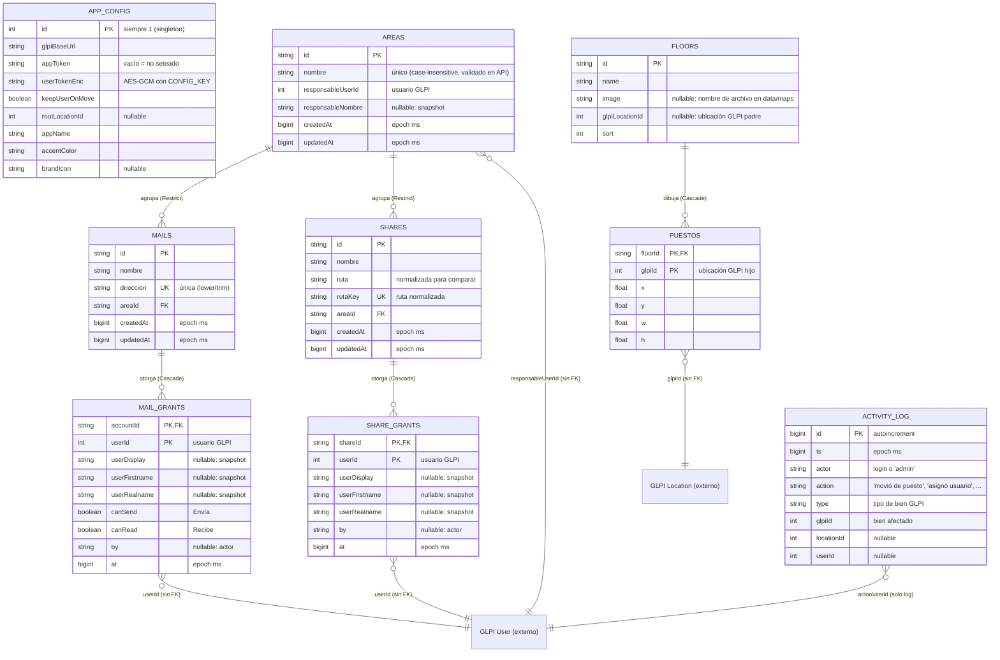

# 10 — DER de la base de datos propia (PostgreSQL + Prisma)

Fuente de verdad: [`prisma/schema.prisma`](../prisma/schema.prisma) (migración `0001_init`).
Motor: PostgreSQL 16 (`db` en `docker-compose.yml`). Acceso vía Prisma Client 5.22.

Alcance: **solo la DB propia** (config, planos, accesos, auditoría).
Los bienes, personas y ubicaciones viven en **GLPI 10** (fuente de verdad vía
API REST legacy) y aquí aparecen únicamente como entidades externas
referenciadas por ID numérico (`glpiId`, `userId`, `responsableUserId`).
Sin `DATABASE_URL`, la app usa el fallback JSON en `./data/` con la misma forma
(`scripts/migrate-json-to-pg.mjs` hace el import inicial).

## Detalle por entidad

| Tabla (`@@map`) | PK | FK y borrado | Notas |
|---|---|---|---|
| `app_config` (`AppConfig`) | `id` (siempre 1) | — | Singleton. Secretos cifrados; tokens nunca salen al navegador (solo flags `*Set`). |
| `floors` (`Floor`) | `id` (string) | — | `image`: archivo en `./data/maps/`; `glpiLocationId`: padre GLPI para calibrar. |
| `puestos` (`Puesto`) | `(floorId, glpiId)` compuesta | `floorId → floors.id` **Cascade** | Rectángulos en % (`x,y,w,h` 0–100). `glpiId` = hijo GLPI dibujado. |
| `areas` (`Area`) | `id` (string) | — | `responsableUserId` + snapshot `responsableNombre` (GLPI puede cambiar el nombre). |
| `mails` (`Mail`) | `id` | `areaId → areas.id` **Restrict** | `direccion` UNIQUE. Borrado con grants → `409` salvo `?force=1`. |
| `shares` (`Share`) | `id` | `areaId → areas.id` **Restrict** | `rutaKey` UNIQUE (ruta normalizada `/`→`\`, sin trailing). Igual regla 409/force. |
| `mail_grants` (`MailGrant`) | `(accountId, userId)` compuesta | `accountId → mails.id` **Cascade** | Al menos un check (`canSend`/`canRead`); upsert idempotente. Sin FK a GLPI. |
| `share_grants` (`ShareGrant`) | `(shareId, userId)` compuesta | `shareId → shares.id` **Cascade** | Acceso sí/no (existencia del grant). Sin FK a GLPI. |
| `activity_log` (`Activity`) | `id` autoincrement | — | Auditoría liviana, recortada a las últimas 100 (igual que `activity.json`). Solo lectura en UI. |

## Reglas de integridad (coherentes con la API)

- **Restrict en áreas**: no se puede borrar un área con correos/carpetas (`409` con conteo; la UI lo explica antes de confirmar).
- **Cascade en puestos/grants**: borrar un piso elimina sus rectángulos; borrar un correo/carpeta (con `force`) elimina sus grants.
- **Sin FK hacia GLPI** (base externa, sin constraints posibles): `userId`, `responsableUserId` y `glpiId` se validan por API (`GET /User/{id}`) al momento de escribir, y los nombres se guardan como snapshot (`userDisplay`, `responsableNombre`).
- **Timestamps**: `BigInt` con epoch en ms (compatibles con el formato previo de `access.json`).
